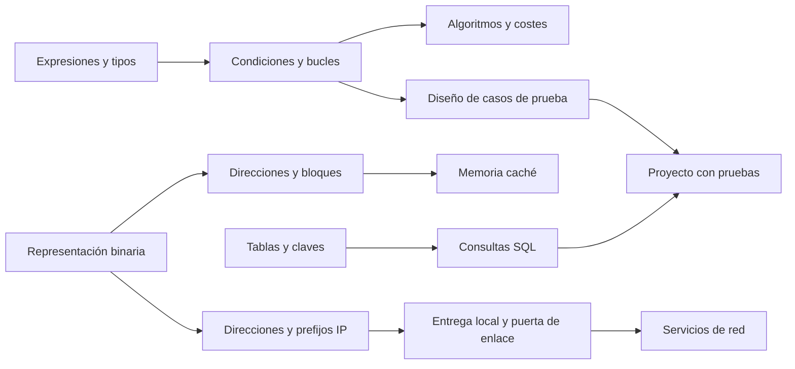
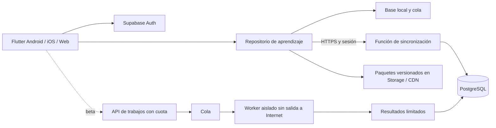

# Trama · Informática a tu ritmo

**Diseño de producto y plan de lanzamiento · 4 de noviembre de 2026**  
Nombre de trabajo. Producto independiente en español para aprender conceptos de informática y comprobar días después si se siguen sabiendo aplicar. El piloto abarcará tres materias. La versión actual cubre cuatro lecciones por materia.

## 1. Plan de estudios y mapa de conocimientos

El plan 205 del Grado en Ingeniería Informática – Ingeniería del Software comprende **240 ECTS**. Son 60 de formación básica, 138 obligatorios, 30 optativos y 12 del TFG. El catálogo contiene 47 entradas, incluidas las alternativas de cuarto. Las prácticas externas permiten obtener 6 créditos optativos. La tabla recoge datos oficiales y añade en la última columna nuestra clasificación editorial. La oferta efectiva de optativas de un curso debe comprobarse en la matrícula de ese año. [Plan de la ETSII](https://www.informatica.us.es/index.php/grados/ingenieria-del-software/plan-de-estudios) · [Ficha del título y catálogo institucional](https://www.us.es/estudiar/que-estudiar/oferta-de-grados/grado-en-ingenieria-informatica-ingenieria-del-software)

| Curso | Código | Asignatura | ECTS | Carácter | Área en Trama |
|---:|---|---|---:|---|---|
| 1 | 2050006 | Administración de Empresas | 6 | Formación Básica | Empresa y sociedad |
| 1 | 2050007 | Álgebra Lineal y Numérica | 6 | Formación Básica | Matemáticas |
| 1 | 2050002 | Cálculo Infinitesimal y Numérico | 6 | Formación Básica | Matemáticas |
| 1 | 2050003 | Circuitos Electrónicos Digitales | 6 | Formación Básica | Computadores y sistemas |
| 1 | 2050008 | Estadística | 6 | Formación Básica | Matemáticas |
| 1 | 2050009 | Estructura de Computadores | 6 | Formación Básica | Computadores y sistemas |
| 1 | 2050001 | Fundamentos de Programación | 12 | Formación Básica | Software y algoritmos |
| 1 | 2050004 | Fundamentos Físicos de la Informática | 6 | Formación Básica | Computadores y sistemas |
| 1 | 2050005 | Introducción a la Matemática Discreta | 6 | Formación Básica | Matemáticas |
| 2 | 2050010 | Análisis y Diseño de Datos y Algoritmos | 12 | Obligatoria | Software y algoritmos |
| 2 | 2050015 | Arquitectura de Computadores | 6 | Obligatoria | Computadores y sistemas |
| 2 | 2050016 | Arquitectura e Integración de Sistemas Software | 6 | Obligatoria | Software y algoritmos |
| 2 | 2050046 | Introducción a la Ingeniería del Software y los Sistemas de Información I | 6 | Obligatoria | Software y algoritmos |
| 2 | 2050047 | Introducción a la Ingeniería del Software y los Sistemas de Información II | 6 | Obligatoria | Software y algoritmos |
| 2 | 2050012 | Lógica Informática | 6 | Obligatoria | Matemáticas |
| 2 | 2050017 | Matemática Discreta | 6 | Obligatoria | Matemáticas |
| 2 | 2050013 | Redes de Computadores | 6 | Obligatoria | Redes y seguridad |
| 2 | 2050014 | Sistemas Operativos | 6 | Obligatoria | Computadores y sistemas |
| 3 | 2050023 | Arquitectura y Servicios de Redes | 6 | Obligatoria | Redes y seguridad |
| 3 | 2050048 | Diseño y Pruebas I | 6 | Obligatoria | Software y algoritmos |
| 3 | 2050049 | Diseño y Pruebas II | 6 | Obligatoria | Software y algoritmos |
| 3 | 2050020 | Ingeniería de Requisitos | 6 | Obligatoria | Software y algoritmos |
| 3 | 2050024 | Inteligencia Artificial | 6 | Obligatoria | Datos e inteligencia artificial |
| 3 | 2050021 | Modelado y Simulación Numérica | 6 | Obligatoria | Matemáticas |
| 3 | 2050025 | Modelado y Visualización Gráfica | 6 | Obligatoria | Señal y gráficos |
| 3 | 2050022 | Procesamiento de Señales Multimedia | 6 | Obligatoria | Señal y gráficos |
| 3 | 2050050 | Proceso Software y Gestión I | 6 | Obligatoria | Software y algoritmos |
| 3 | 2050051 | Proceso Software y Gestión II | 6 | Obligatoria | Software y algoritmos |
| 4 | 2050027 | Acceso Inteligente a la Información | 6 | Optativa | Datos e inteligencia artificial |
| 4 | 2050028 | Ampliación de Administración de Empresas | 6 | Optativa | Empresa y sociedad |
| 4 | 2050029 | Aplicaciones de Soft Computing | 6 | Optativa | Datos e inteligencia artificial |
| 4 | 2050037 | Complementos de Bases de Datos | 6 | Optativa | Datos e inteligencia artificial |
| 4 | 2050030 | Criptografía | 6 | Optativa | Redes y seguridad |
| 4 | 2050031 | Derecho en la Informática | 6 | Optativa | Empresa y sociedad |
| 4 | 2050038 | Estadística Computacional | 6 | Optativa | Matemáticas |
| 4 | 2050032 | Evolución y Gestión de la Configuración | 6 | Obligatoria | Software y algoritmos |
| 4 | 2050033 | Gestión de la Producción | 6 | Optativa | Empresa y sociedad |
| 4 | 2050039 | Ingeniería del Software y Práctica Profesional | 6 | Obligatoria | Software y algoritmos |
| 4 | 2050034 | Métodos Cuantitativos de Gestión | 6 | Optativa | Matemáticas |
| 4 | 2050041 | Optimización de Sistemas | 6 | Optativa | Matemáticas |
| 4 | 2050035 | Planificación y Gestión de Proyectos Informáticos | 6 | Obligatoria | Empresa y sociedad |
| 4 | 2050026 | Prácticas Externas | 6 | Optativa | Práctica y proyecto |
| 4 | 2050042 | Procesamiento de Imágenes Digitales | 6 | Optativa | Señal y gráficos |
| 4 | 2050043 | Seguridad en Sistemas Informáticos y en Internet | 6 | Optativa | Redes y seguridad |
| 4 | 2050036 | Tecnología, Informática y Sociedad | 6 | Optativa | Empresa y sociedad |
| 4 | 2050044 | Teledetección | 6 | Optativa | Señal y gráficos |
| 4 | 2050045 | Trabajo Fin de Grado | 12 | Trabajo fin de grado | Práctica y proyecto |

### Trazabilidad de las primeras rutas

| Materia | Qué se ha comprobado | Competencia observable propuesta por Trama |
|---|---|---|
| Fundamentos de Programación | El programa 2025–26 incluye Python, control de flujo, estructuras de datos y una parte de Java. | Seguir un acumulador, escribir una condición y probar un caso límite. [Programa de FP](https://sevius4.us.es/index.php?PyP=LISTA&programa=2050001) |
| Redes de Computadores | El catálogo verifica nombre, segundo curso y 6 ECTS. | Predecir si un destino IPv4 está en la misma red y elegir el siguiente salto. Esta actividad es propia. |
| Arquitectura de Computadores | El programa 2025–26 incluye prestaciones y sistema de memoria. La habilidad HD04 se refiere a comprender y evaluar la arquitectura y sus componentes. | Predecir aciertos y fallos de una caché simplificada y explicar el efecto de reutilizar un bloque. [Programa de AC](https://sevius4.us.es/index.php?PyP=LISTA&programa=2050015) |

Las competencias editoriales de las demás áreas orientan la ampliación del catálogo. En matemáticas, justificar una inferencia o estimar un error. En software, convertir un requisito en una prueba. En sistemas, rastrear un acceso a memoria. En datos, verificar una consulta contra un conjunto pequeño. En señal, predecir el efecto de un filtro. En empresa y práctica profesional, argumentar una decisión con costes y riesgos. Un responsable de contenido debe contrastar cada módulo con el programa docente vigente antes de etiquetarlo como alineado.

### Dependencias recomendadas

Las flechas representan preparación para una actividad de Trama. Permiten tomar un puente o demostrar conocimientos en el diagnóstico. Para matricularse rigen las normas de la universidad.

**Áreas complementarias.** Git para colaborar, accesibilidad de interfaces y automatización de entregas tendrán la etiqueta «Complemento de Trama» y un identificador propio. Las fichas académicas enlazan la universidad y registran código, curso del programa consultado, fecha y revisor. Ejercicios, ilustraciones y explicaciones serán originales o tendrán licencia compatible documentada. Publicar un programa docente no concede permiso para reutilizar sus materiales, exámenes, marcas o logotipos.

## 2. Producto y alcance

**Decisión de lanzamiento.** Empezar por tres recorridos independientes, de cuatro lecciones cada uno. Así se puede contrastar la misma mecánica en tres tareas diferentes: escribir una condición, seguir un paquete y razonar sobre memoria. Solo se ampliará una ruta si los alumnos pueden resolver una variante nueva una semana después.

| Perfil e historia de usuario | Comportamiento requerido | Criterio para aceptar el piloto |
|---|---|---|
| Principiante que estudia diez minutos en el autobús. «Quiero aprender programación desde cero». | Elegir una sola materia, saltar diagnóstico, descargar unidad y estudiar en modo avión. | Completa una unidad descargada tras reiniciar el móvil. Al reconectar conserva todos sus intentos. |
| Estudiante que prepara Redes. «Ya sé direccionamiento y quiero practicar errores». | Diagnóstico breve, salto de conceptos conocidos y repaso diario. | Una variante fallada vuelve con explicación. El panel distingue acierto inmediato de recuerdo diferido. |
| Profesional que retoma arquitectura. «Quiero alternar portátil y móvil». | Cuenta opcional, recomendación explicable, ejercicios accesibles con teclado. | Un intento reenviado dos veces da una sola evidencia y una sola recompensa. |
| Revisor docente. «Quiero corregir una pregunta sin alterar el historial». | Publicación de paquetes versionados tras revisión disciplinar y de accesibilidad. | Un intento antiguo sigue asociado al enunciado y la rúbrica originales. |

**Imprescindible para el MVP público:** entrada como invitado, selección múltiple, recorrido por materia, diagnóstico opcional, 12 microlecciones, elección y respuesta breve, completar código guiado, trazas locales, revisión espaciada, progreso por competencia, persistencia y sincronización de cuenta opcional. En modo invitado el dispositivo conserva los datos. Asociarlos a una cuenta requiere una decisión expresa. No se promete cubrir una materia universitaria completa con cuatro lecciones.

**Después del MVP:** Python remoto con tests ocultos tras auditoría, simulaciones de CPU, circuitos, redes, planificación de procesos y SQL; editor docente, suscripción, misiones semanales e idiomas adicionales. El primer piloto funcionará sin anuncios. El TFG y las prácticas externas tendrán fichas de orientación, sin equivalencia académica ni evaluación universitaria.

**Requisitos no funcionales y medición.** Objetivos de aceptación: feedback local p95 inferior a 200 ms en móvil de referencia de gama media; paquete de unidad textual inferior a 1 MB, tamaño mostrado antes de descargar; recorrido completo al 200 % de texto con lector de pantalla y teclado; cero cruces de datos en pruebas entre dos cuentas. Medir aprendizaje por recuperación a siete días sobre variantes nuevas, con denominador de quienes vuelven y tasa de retorno por separado. Mostrar ejemplos fallados además del porcentaje. Medir abandono en cada paso para distinguir falta de comprensión de un problema de interfaz.

**Arquitectura inicial acordada para el diseño.** Una aplicación Flutter con un repositorio local, un catálogo versionado y un único servicio gestionado de autenticación y PostgreSQL. Supabase interviene cuando el alumno decide sincronizar. La lección funciona por sí sola. El evaluador arbitrario tendrá su propia frontera de seguridad cuando se incorpore.

## 3. Diseño pedagógico

Cada **asignatura** contiene módulos temáticos. Cada **módulo** agrupa unidades con una meta demostrable. Cada **unidad** contiene lecciones de 3–10 minutos. Cada **lección** combina breve explicación, predicción, práctica con feedback y transferencia. Cada **ejercicio** declara competencia, dificultad, variante, versión, solución y motivo de cada distractor. Ejemplo: Fundamentos de Programación → Control de flujo → Decidir en un límite → «Contar sin perder el cero» → completar el operador y justificar el caso frontera.

**Diagnóstico y adaptación.** Al elegir materia se ofrecen tres ejercicios de entrada, con «Todavía no lo sé». Dos respuestas autónomas en variantes distintas permiten saltar la explicación inicial. El diagnóstico orienta la ruta. Un fallo propone un ejemplo resuelto y una variante más sencilla. Dos éxitos independientes llevan a una tarea de transferencia. El algoritmo recomienda, por orden, repaso vencido, concepto puente o siguiente competencia del objetivo elegido. Explica la decisión y permite escoger otra actividad.

**Dominio.** Un intento registra ítem, versión, momento, competencia, ayuda y resultado. El piloto exige dos variantes distintas correctas sin pista y una tercera variante nueva correcta al menos 24 horas después. Si falta esta última evidencia, el panel muestra «En práctica». Un fallo posterior marca «Para repasar». Calendario inicial de 1, 3, 7 y 14 días desde la recuperación correcta; tras fallo, volver al día siguiente. Son hipótesis a calibrar por concepto. El primer incremento de software muestra aciertos y revisiones locales; la etiqueta «dominado» se reserva para cuando exista ese banco de variantes.

**Motivación.** Otorgar 10 XP por primera finalización de cada lección, incluso con errores. La racha cuenta días de práctica en la zona elegida y admite pausas; perder un día conserva temario y XP. Misiones futuras como «revisar dos conceptos pendientes» e insignias cosméticas. Intentos ilimitados. El panel muestra tema, pruebas observadas, última recuperación, siguiente revisión y una acción concreta.

La ficha [Revisión docente](revision-docente.html) recoge las doce lecciones implementadas, ejercicios, claves, feedback, variantes y referencias.

### Tres ejemplos de lecciones

| Lección y tiempo | Guion y ejercicio guiado | Transferencia, solución y feedback |
|---|---|---|
| **Contar sin perder el cero**, 5 min. Meta: traducir «no negativo» a una condición. Requiere comparar enteros. | 1 min: un torno cuenta cada lectura aceptada. 1 min: recorrer −2, 0, 3 y anotar contador 0, 1, 2. 2 min: en Python completar la condición `if x __ 0:` dentro del bucle que incrementa el contador. | `>=` incluye el cero. `>` lo pierde. Probar lista vacía → 0; [0] → 1; [−1,2,4] → 2. Último minuto: si se piden estrictamente positivos, elegir `>` y explicar por qué [0] da 0. |
| **El primer salto**, 5 min. Meta: decidir a quién entregar una trama IPv4. Requiere reconocer el prefijo /24. | 1 min: el repartidor usa un intermediario si sale del barrio. 1 min: dibujar host 192.0.2.10/24 y puerta 192.0.2.1, sin rutas particulares. 2 min: al enviar a 198.51.100.7, elegir siguiente salto. | Respuesta 192.0.2.1; la IP de destino del paquete sigue siendo 198.51.100.7. El gateway es el vecino local. Transferencia: hacia 192.0.2.44 se entrega directamente en la LAN. Si se elige el gateway, sombrear los tres primeros octetos iguales y volver a comparar. |
| **Una caché de una línea**, 6 min. Meta: predecir reutilización en un modelo simple. Requiere distinguir dirección y contenido. | 1 min: una bandeja guarda el último libro consultado. 1 min: caché vacía de una línea, un bloque por acceso. 2 min: leer bloques A,A,B. Predecir fallo, acierto, fallo; mostrar tras cada lectura qué bloque queda. | 2 min: añadir A. Hay fallo porque B reemplazó a A. En A,B,B,A solo hay un acierto. Elegir «dos» suele indicar que se recuerda que A pasó por la caché pero se ignora el reemplazo. Una caché real puede tener más líneas o vías. |

Cada lección termina con la regla aplicada y una invitación a resolver otra variante al día siguiente. Las tres actividades son originales. El editor guiado valida un operador de una lista cerrada y lo aplica a casos fijos. El editor libre de Python se desarrolla en beta.

## 4. UX/UI y navegación

El estudiante aterriza en **Hoy** con una sola acción principal. Puede abrir **Materias**, **Repaso** o **Perfil**. Guardar es automático al confirmar una respuesta. En el diseño del MVP, salir de una lección permite reanudar el último paso guardado.

| Pantalla | Wireframe de lectura, de arriba abajo | Decisión de interacción |
|---|---|---|
| Bienvenida y selección | Qué aprenderás → duración → tarjetas de materias → «Empezar» | Entrada local sin correo. Se puede añadir o quitar una materia después. |
| Hoy | Próxima acción y motivo → repaso pendiente → materias elegidas | «Tienes dos conceptos para hoy». Un acceso visible abre las descargas. |
| Mapa | Objetivo → lista de unidades → estado y prerrequisito → acción | Secuencia vertical en móvil. Un concepto difícil ofrece «Ver puente» y «Probar antes». |
| Lección | Materia y paso → explicación breve → ejemplo → practicar | Una idea por pantalla. Pausar y volver ocupa el mismo lugar en cada paso. |
| Práctica | Enunciado → opciones o código → comprobar → explicación contextual | Ordenar admite botones subir/bajar. El editor muestra resultados de prueba en texto seleccionable. |
| Resultados | Evidencias por concepto → regla para recordar → próximo repaso | La acción de continuar siempre está visible. No hay compras ni mensajes de presión en errores. |
| Perfil | Progreso por materia → competencias → XP → preferencias, privacidad y cuenta | Separar «lo que he practicado» de «lo que recuerdo». Exportar o borrar datos desde este punto. |

**Diseño visual.** Identidad propia de cuaderno de laboratorio. Fondo marfil, tinta azul oscura y acento verde petróleo. En oscuro, fondo azul carbón y acento menta. Tokens semánticos para superficie, texto, acción, éxito y revisión; error incluye icono y explicación. Escala de 4/8/16/24/32 px, texto de cuerpo a partir de 16 y controles de 48 px. Componentes compartidos: tarjeta de materia, paso de unidad, panel de código, respuesta seleccionable, aviso de conexión y tarjeta de evidencia. Un móvil usa una columna; a partir de 720 px, navegación lateral y una columna de lectura acotada; en escritorio ancho, panel de traza al lado del ejercicio. En tablet vertical prima el tamaño efectivo disponible.

**Accesibilidad y red.** Semántica para estados y diagramas, tabla textual para toda simulación, foco visible, orden lógico, tamaño de letra del sistema, contraste objetivo WCAG AA y opción de movimiento reducido. Sin sonido obligatorio. Separar textos de la lógica y parametrizar plurales antes de traducir. Ofrecer descargas por unidad con tamaño, versión, control de borrado y opción solo wifi.

## 5. Arquitectura, datos y seguridad

| Alternativa | Auth, API y control de acceso | Coste, escala y trabajo del equipo |
|---|---|---|
| **Supabase + PostgreSQL**, elección propuesta | Auth gestionada, API de lectura, políticas por fila y transacciones SQL. Una función protegida valida intentos y coordina sincronización. | Base gestionada con coste por plan, cómputo, tráfico y almacenamiento. SQL facilita reconstruir evidencias e investigar errores. Hay que construir cola offline y probar cada política. [Precios](https://supabase.com/pricing) · [RLS](https://supabase.com/docs/guides/database/postgres/row-level-security) |
| **Firebase Auth + Firestore** | Autenticación y reglas por documento. SDK con caché y sincronización en plataformas compatibles; en web se configura la persistencia. | Escala gestionada. Lecturas, escrituras y tráfico crecen con el uso. Sus relaciones requerirían desnormalización y actualizaciones coordinadas. La política de última escritura para un documento no basta para los intentos. [Persistencia offline](https://firebase.google.com/docs/firestore/manage-data/enable-offline) · [Facturación](https://firebase.google.com/docs/firestore/pricing) |
| **NestJS + PostgreSQL** | API REST propia, proveedor OIDC, autorización y migraciones a cargo del equipo. | Más control sobre trabajos y límites; costes de máquinas, base, guardias, parches y restauraciones. Réplicas y workers se pueden añadir por separado. Considerarlo si los requisitos de aislamiento o de contrato superan al servicio gestionado. [Autenticación en NestJS](https://docs.nestjs.com/security/authentication) |

**Modelo persistente propuesto.** Identificadores opacos y tiempos UTC salvo el día local de racha. Las claves de usuario proceden de la sesión. Las proyecciones se pueden regenerar a partir de los intentos.

| Tablas | Claves y restricciones que importan |
|---|---|
| profiles, enrollments | profiles.id referencia auth.users; (user_id,subject_id) único, zona horaria, meta y estado activo. |
| subjects, modules, units, lessons, items | FK al padre, orden único por padre; origen académico o complementario, código oficial opcional; (item_id,version) inmutable; localización, licencia, autor y revisión. |
| concepts, item_concepts, prerequisites | Relación N:M con peso; arista única (anterior,siguiente); rechazar ciclos antes de publicar. |
| bundles | (unit_id,version), manifiesto firmado con hash de archivos, tamaño, versión mínima de cliente y fecha. |
| attempts | PK (user_id,event_id), item y versión, respuesta normalizada, ayudas, instante ocurrido/recibido y resultado calculado por servidor. Índice por usuario, concepto y fecha. |
| progress, reviews | (user_id,concept_id), estado, evidencia reciente y due_at. Se recalculan tras lotes tardíos. |
| xp_ledger, activity_days, achievements, user_achievements | Restricciones únicas sobre usuario y causa de XP, usuario y día de práctica, usuario y logro. Racha derivada de días distintos. |
| sync_changes, device_cursors, local_outbox | Secuencia de servidor monotónica por usuario, tombstones de borrado, cursor por dispositivo, evento local pendiente hasta acuse. |
| submissions | Propietario, versión de rúbrica, job_id, estado, límites y caducidad. Las pruebas ocultas viven fuera de los paquetes públicos. |

**Contrato de servicio del MVP.** GET /catalog?since=v devuelve cambios y versiones. GET /bundles/{id}/{version} entrega un manifiesto verificable. POST /sync acepta hasta 100 eventos con event_id, item_id, version, answer y happened_at. Devuelve acuse por evento y cursor. GET /changes?after=c pagina actualizaciones y borrados. PATCH /preferences exige versión esperada y devuelve 409 con valores actuales si hay conflicto. En beta, POST /submissions devuelve 202 y job_id, GET /submissions/{id} comprueba propiedad y devuelve estado. 401 requiere renovar sesión, 422 explicar evento inválido, 429 reintentar con espera. Ninguna operación confía en XP o corrección enviados por el cliente.

**Offline y conflictos.** La primera entrega usa Sembast en un archivo privado nativo y sobre IndexedDB en web. Una transacción guarda el resultado antes de avanzar. Para el MVP guardar intento y outbox en la misma transacción. Descargar una unidad en zona temporal, verificar firma y hashes y activar su versión de forma atómica. Conservar la versión a la que apunte una sesión abierta. En web almacenar también el shell y recursos de render mediante un service worker versionado para poder arrancar sin conexión tras la primera visita. Si el navegador deniega almacenamiento o se queda sin cuota, mostrar estado y permitir liberar unidades sin borrar intentos. [Sembast](https://pub.dev/packages/sembast) · [Sembast Web](https://pub.dev/packages/sembast_web)

El servidor une intentos por identificador, conserva intentos distintos de ambos dispositivos y procesa cada lote en una transacción. Si llega el mismo ID con contenido diferente, responde conflicto y conserva el original. Un acuse perdido provoca reenvío con el mismo ID; añadir espera exponencial con variación. Preferencias con control de versión por campo. Una baja gana frente a una edición antigua y no resucita la cuenta; invalidar tokens y eliminar la cola al confirmar baja. Marcar tiempos sospechosos y mostrar el cálculo local como provisional. Guardar cursor solo después de aplicar cada página localmente. Pruebas dirigidas: desconexión tras commit, dos dispositivos, reloj adelantado y paquete retirado.

**Evaluación local y remota.** Sin red: opciones, ordenación, trazas y un lenguaje cerrado para huecos de código. En beta, guardar borrador de código libre sin conexión; ejecutar solo bajo petición al recuperar red. API admite inicialmente Python, fuente ≤16 KiB, cuota inicial 10 envíos/minuto y dos trabajos por usuario. Trabajos efímeros en nodo Linux dedicado con gVisor o microVM, usuario sin privilegios, sistema raíz de solo lectura, sin montajes del host ni credenciales; red denegada, incluidos DNS y metadatos. Objetivos iniciales 1 s de CPU, 3 s de reloj, 128 MiB RAM, 16 procesos, 8 MiB temporales y 8 KiB de salida. Supervisor externo mata todo el grupo al vencer límites. El supervisor conserva entradas y oráculos privados fuera del proceso del alumno, devuelve diferencias pedagógicas acotadas y destruye el entorno tras cada caso. Verificar con bucles, fork bomb, salida ilimitada, lectura ajena y conexiones salientes. Un contenedor compartido sin aislamiento adicional queda fuera del diseño. [Modelo de seguridad de gVisor](https://gvisor.dev/docs/architecture_guide/security/)

**Operación.** Hosting web estático HTTPS y caché de activos por hash. Base y almacenamiento gestionados en región UE a confirmar contractualmente. Separar pruebas y producción. Roles alumno/revisor/editor, MFA de edición, claves privilegiadas solo en servidor, validación de esquema y límites por sesión/IP. Pruebas negativas de RLS con dos usuarios para SELECT, escritura, storage y funciones. En móviles guardar tokens en almacén seguro del sistema; web con CSP restrictiva y sesión breve, valorar backend de sesión con cookies HttpOnly y protección CSRF. Evitar PII, código y respuestas en logs. Panel mínimo de latencia, fallos de sync, tamaño de cola, coste por 100 sesiones y restauraciones. Copia diaria cifrada de BD y copia independiente de contenidos con versiones. Objetivos RPO 24 h, RTO 8 h; ensayo trimestral de restauración. Medir índices y uso antes de añadir réplicas; escalar workers por cola y cortar admisión al llegar al presupuesto.

**Retención propuesta.** Mantener progreso mientras la cuenta esté activa; avisar tras 24 meses de inactividad antes de purgar. Logs operativos 30 días, código de envíos 7 días salvo guardado voluntario, copias rotativas hasta 30 días. Solicitud de borrado elimina datos activos y bloquea reimportación desde copias. Publicar plazos, encargados, bases por finalidad y proceso de acceso/exportación/supresión. Revisar obligaciones legales de conservación de facturas por separado antes de activar cobros.

## 6. Monetización que respeta la sesión de estudio

El piloto será gratuito. En beta se podrá ensayar un patrocinio contextual **solo al terminar una unidad** y después de mostrar los resultados, con «Continuar» visible. Tope experimental de una impresión por sesión y dos por día. En móvil, un vídeo voluntario puede desbloquear una apariencia. Sin conexión o sin inventario, continuar al instante. Cero anuncios en diagnóstico, repaso, lección, examen y editor. En web, priorizar patrocinio estático propio sin identificadores de terceros. No enviar materia elegida, fallos ni nivel al anunciante.

La suscripción propuesta elimina anuncios y añade planificación avanzada, temas visuales e informes personales ampliados. Contenidos esenciales, pruebas, repaso y accesibilidad siguen siendo gratuitos. Validar compras y renovaciones en servidor, restaurar compras y gestionar cancelaciones; revisar reglas vigentes de Apple y Google según mercado antes de ofrecer pagos. Web con proveedor de pagos alojado y derechos ligados a cuenta. El precio y los ingresos se validarán con el piloto.

**Privacidad.** Separar prestación educativa, medición opcional y publicidad. Consentimiento granular para finalidades que lo requieran, igual facilidad de rechazar y retirar; no iniciar un SDK no esencial antes de decidir. Piloto de cuentas para adultos. Si se incorporan menores, diseñar comprobación proporcional, consentimiento del representante cuando proceda y experiencia sin publicidad ni perfilado para menores o edad desconocida. En España, el art. 7 de la LOPDGDD contempla consentimiento del titular de la patria potestad o tutela para menores de 14 años cuando el tratamiento se base en consentimiento. Revisar evaluación de impacto, accesos de encargados y transferencias antes de abrir cuentas. [RGPD](https://eur-lex.europa.eu/eli/reg/2016/679/oj) · [LOPDGDD, art. 7](https://www.boe.es/buscar/act.php?id=BOE-A-2018-16673#a7) · [Guía de cookies AEPD](https://www.aepd.es/guias/guia-cookies.pdf)

**Regla para retirar el ensayo.** Comparar cohortes adultas equivalentes con y sin patrocinio. Métricas: abandono tras resultados, paso a la siguiente lección, recuperación a siete días, quejas y tiempo añadido. Pausar de inmediato por anuncios en ejercicios o exposición a menores. Como umbrales iniciales, pausar para investigar si abandono sube 3 puntos porcentuales o transferencia baja 5 puntos frente al control. Revisar tamaño muestral e incertidumbre antes de escalar. Ingresos por sí solos no justifican mantener una ubicación.

## 7. Desarrollo, pruebas y distribución

La entrega incluye un proyecto Flutter con carpetas android, ios y web. lib/lessons.dart contiene el contenido original y su corrección determinista. lib/data separa apertura de la base por plataforma y transacciones de sesiones. lib/main.dart contiene selección, lección, resultados y panel. test/ comprueba el flujo desde la pantalla inicial, los casos de borde y el guardado idempotente. Para este tamaño basta estado de pantalla de Flutter y un repositorio inyectado. Al incorporar cuentas, extraer controladores por funcionalidad (catálogo, estudio, progreso, sync) que observen el repositorio. Mantener el adaptador remoto fuera de los componentes visuales.

**Entrega incremental · actualizada el 11 de noviembre de 2026.** La aplicación guarda cada respuesta al comprobarla. Al volver, continúa en la primera pregunta pendiente. La última respuesta cierra la sesión y los XP se calculan una vez por lección. En las tres materias, «Repasar hoy» ofrece una variante a partir de las 24 horas de la primera finalización y después a intervalos de 3, 7 y 14 días tras sucesivos aciertos. Un fallo programa un repaso al cabo de un día. «Ensayar una variante» permite practicar sin modificar el calendario. El panel separa práctica y recuerdo observado. Están implementadas las 12 lecciones y el diagnóstico opcional de tres preguntas por materia. El alumno puede abrir cualquier lección. El diagnóstico orienta el inicio y se guarda por separado sin otorgar XP ni acreditar recuerdo. Las doce lecciones y sus variantes están pendientes de revisión docente externa. La descarga selectiva está implementada: tres lecciones vienen incluidas y nueve se guardan a petición, con comprobación de integridad y borrado sin perder progreso. La sincronización manual de sesiones terminadas y repasos está implementada y verificada en local; su activación y la prueba entre dispositivos reales siguen pendientes porque aún no existe un proyecto de Supabase. Los borradores, diagnósticos, materias elegidas y descargas permanecen en cada dispositivo. No hay todavía registro público ni sincronización automática.

**CI y artefactos.** En cada cambio, resolver el lockfile, analizar, ejecutar pruebas y compilar web. En las compilaciones móviles usar la misma revisión y el mismo SDK fijado. Android necesita JDK, SDK/Gradle y aceptar sus licencias; para distribuir, configurar clave de subida privada y firma de release, generar AAB y pasar pista interna. El APK de depuración sirve para ensayos. iOS necesita macOS con Xcode compatible; compilar para simulador valida código sin firmar para dispositivos. Para TestFlight/App Store registrar identificador, equipo, certificados y perfiles y generar un IPA firmado. Secretos solo en entorno protegido, nunca en Git. Web se sirve por HTTPS con la base URL correcta. Promover un artefacto que ya haya pasado pruebas y conservar la versión anterior para rollback. [Publicación iOS](https://docs.flutter.dev/deployment/ios) · [Publicación Android](https://docs.flutter.dev/deployment/android)

**Pruebas antes de beta.** Unitarias para diagnóstico, evidencias, vencimientos y medianoche; widgets para lector, teclado y texto ampliado; integración real en Android, iOS y navegador con cierre y reapertura offline. Añadir migración desde la versión anterior, dos pestañas web, dispositivos concurrentes, borrado, reenvío y reconexión con token caducado. Contratos de backend y pruebas adversas del runner forman parte de la puerta de salida correspondiente.

## 8. Roadmap, presupuesto y puertas de lanzamiento

### Plan de presentación a dirección · noviembre y diciembre de 2026

**Fecha objetivo propuesta: 16 de diciembre**, con margen hasta el 22 para correcciones. Es una fecha de trabajo pendiente de acordar con la escuela. La presentación y la autorización de un piloto con alumnado son decisiones diferentes. El objetivo de la reunión es obtener dos revisores docentes y autorización para evaluar el piloto.

| Fecha límite | Entrega y responsable propuesto | Evidencia para aceptar |
|---|---|---|
| 6 nov. | Ingeniería entrega reanudación y repaso en las tres materias. | Recargar tras dos respuestas, continuar en la tercera y conservar los XP. Una variante vencida actualiza el recuerdo; un ensayo inmediato conserva el calendario. |
| 20 nov. | Desarrollo entregado: 12 lecciones, variantes y diagnóstico inicial. Pendiente de revisión por docentes. | Cuatro lecciones por materia, objetivos observables, procedencia y licencias. Dos revisores propuestos; registrar observaciones y correcciones. Probar la selección libre y el salto por conocimientos previos. |
| 27 nov. | Ingeniería entrega descarga por unidad y sincronización opcional en entorno de pruebas. | Dos dispositivos convergen tras reconectar sin duplicar intentos ni XP. El invitado puede terminar y reanudar sin cuenta. Comprobar aislamiento entre usuarios y restauración. |
| 4 dic. | Ingeniería y QA preparan la candidata web, Android e iOS y abren el ensayo interno. | Completar la misma unidad en dispositivos reales, con reinicio sin red, teclado, lector de pantalla y texto ampliado. Ensayar recuperación de una versión anterior. |
| 11 dic. | Producto revisa la experiencia con voluntarios adultos, si se han obtenido permisos. | Documentar cuántos comienzan, terminan, vuelven a los siete días y resuelven una variante. Anotar denominadores y problemas observados. Si el plazo o la muestra son insuficientes, declarar pendientes esos datos. |
| 16 dic. | Dirección recibe una demostración reproducible, inventario de requisitos y propuesta de piloto. | Mostrar una interrupción real y un ensayo libre. Para demostrar repaso diferido, usar una sesión de demostración completada al menos 24 horas antes. Separar evidencia técnica y resultados de estudiantes. |

**Condiciones para llamarlo MVP completo.** Las 12 lecciones y el diagnóstico pasan revisión, las unidades elegidas funcionan offline, la cuenta opcional sincroniza sin pérdida, las tres plataformas pasan pruebas en dispositivos o navegadores de referencia y se revisan privacidad y accesibilidad. El 11 de diciembre se decide si presentar el MVP completo o una versión demostrable con carencias identificadas. La cuenta de desarrollo iOS, acceso a dispositivos, infraestructura de pruebas y disponibilidad docente son dependencias que conviene resolver en noviembre. Ads, suscripción y ejecución libre de Python quedan fuera de esta presentación.

### Evolución y lanzamiento público posterior

| Etapa y prioridad | Plazo orientativo y responsable | Dependencias | Criterio de salida |
|---|---|---|---|
| Incremento local P0 | Entrega actual. Ingeniería + contenidos | SDK, almacenamiento local, doce lecciones | Elegir materia, practicar, ver explicación, guardar sesión y recuperarla. |
| MVP privado P0 | Semanas 1–6. Producto, ingeniería y dos revisores a tiempo parcial | Revisar guías anuales; ampliar a 12 lecciones y crear variantes; privacidad; cuenta optativa | 12 lecciones revisadas; diagnóstico, repaso y accesibilidad; resolver unidad descargada tras reinicio, dos dispositivos convergen tras reenvío; restaurar copia de prueba. |
| Beta cerrada P1 | Semanas 7–10. Ingeniería, seguridad y docencia | MVP estable, build móvil en cada plataforma, cuentas de distribución, cohorte adulta | 50–100 participantes voluntarios, observar errores en sesiones moderadas y transferencia a 7 días. Runner solo tras superar abuso y aislamiento. |
| Lanzamiento limitado P1 | Semanas 11–12, condicionado a resultados | Corrección de bloqueos, soporte, revisión de tiendas y permisos | Cero incidentes abiertos de pérdida de datos o fuga entre usuarios, ejecución de prueba en dispositivos reales, protocolo de rollback y presupuesto activo. |
| Evolución P2 | Tras validar aprendizaje y retorno | Banco de variantes, revisión de derechos, capacidad de soporte | Ampliar una materia cada vez; habilitar suscripción o patrocinio solo tras el ensayo controlado. |

**Presupuesto de planificación, sin valor de oferta.** Equipo equivalente a dos jornadas completas durante 12 semanas, 5 días por semana: 120 jornadas. Con un coste interno supuesto de 250–450 €/jornada, desarrollo, contenidos y QA suponen **30.000–54.000 €**. Reservar además 3–5 jornadas de revisión externa a 400–700 € si se habilita ejecución remota (1.200–3.500 €). Sin IVA, captación, comisiones de tiendas, hardware ni soporte posterior. La validación docente es una partida de trabajo incluso si la infraestructura inicial es gratuita.

**Infraestructura.** Escenario piloto: 500 usuarios activos al mes × 12 sesiones × 6 eventos = 36.000 eventos/mes. Con paquetes de 1 MB y dos descargas por usuario, 1 GB/mes de contenido, además de app web, backups y observabilidad. Reservar **30–100 €/mes** para servicio gestionado, hosting y copias como hipótesis presupuestaria, sujeta a región, divisa, impuestos y nivel de servicio. Beta: 2.000 activos × 4 envíos remotos × 3 s = 24.000 segundos de ejecución/mes antes de arranque, aislamiento y holgura por concurrencia. Reservar adicionalmente **50–250 €/mes** para evaluador, registros y capacidad base; cotizar con pruebas de carga. Vigilar minutos de CI en macOS y costes de las tiendas por separado. El plan gratuito sirve para desarrollo; escoger producción según recuperación, residencia y límites reales. [Precios de Supabase](https://supabase.com/pricing) · [Programa de Apple](https://developer.apple.com/programs/whats-included/)

**Decisión al final del piloto.** Si el equipo solo tiene capacidad para una ampliación, priorizar variantes y repaso diferido sobre nuevas asignaturas. Si el alumnado acaba lecciones pero no resuelve un caso nuevo una semana después, revisar analogías, dificultad y práctica de transferencia antes de añadir contenido o anuncios.
